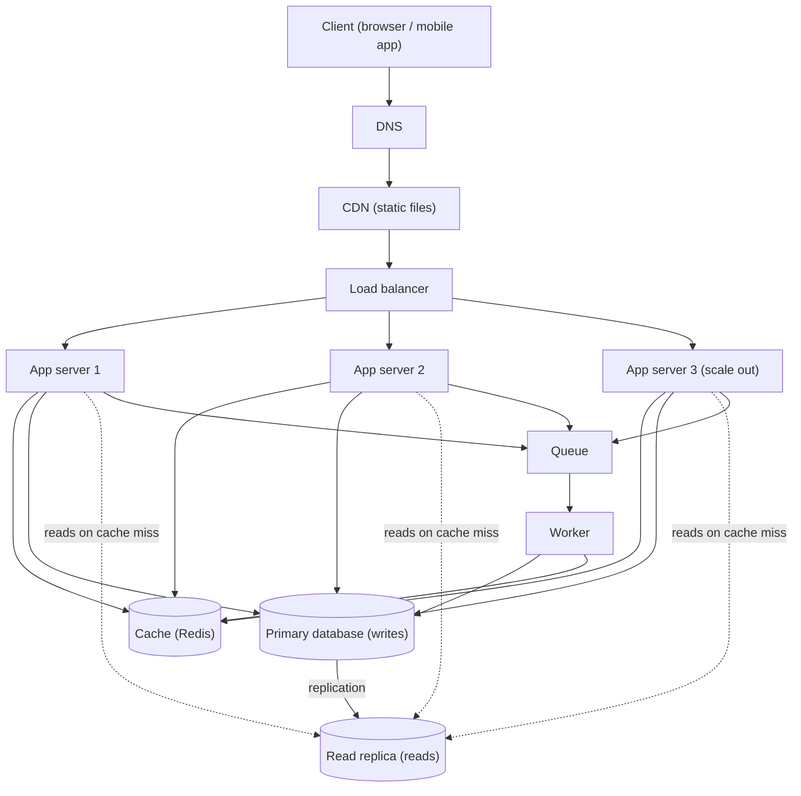

# QuickNotes Architecture

This document describes how QuickNotes can serve **1 million users**. It uses the endpoints in [api-design.md](api-design.md) and the schema in [data-model.md](data-model.md).

## 1. Requirements

### Functional

- Users can register and log in.
- Users can create, read, update and delete their own notes.
- Users can list their notes, newest first, with pagination.
- Users can organise notes with tags and filter by tag.
- Notes are private: a user can never see another user's notes.

### Non-functional

- **Availability:** 99.9% uptime (about 8.8 hours of downtime per year at most).
- **Latency:** 95% of API requests answered in under 300 ms.
- **Scalability:** handle 1 million users now, and grow by adding servers rather than rewriting.
- **Durability:** a saved note is never lost (replicated database, daily backups).
- **Security:** HTTPS everywhere, hashed passwords, token authentication, rate limiting.
- **Consistency:** a user must see their own note immediately after saving it; slightly stale data for a few seconds is acceptable in other places.

## 2. Load estimate (1 million users)

Assumptions: 30% of users are active each day (300,000 daily active users, DAU); each active user makes 20 read requests and 3 write requests per day; peak traffic is 5 times the average; an average note row is about 1.2 KB including overhead.

| Metric | Calculation | Result |
|--------|-------------|--------|
| Read requests per day | 300,000 x 20 | 6,000,000 |
| Reads per second (average) | 6,000,000 / 86,400 | about 70 /s |
| Reads per second (peak) | 70 x 5 | about 350 /s |
| Write requests per day | 300,000 x 3 | 900,000 |
| Writes per second (average) | 900,000 / 86,400 | about 10 /s |
| Writes per second (peak) | 10 x 5 | about 50 /s |
| Read : write ratio | 6,000,000 : 900,000 | about 7 : 1 |
| New notes per year | 900,000 x 365 | about 330 million |
| Storage per year (data) | 330 million x 1.2 KB | about 400 GB |
| Storage per year (with indexes, tags, about +50%) | 400 GB x 1.5 | about 600 GB |

Conclusion: traffic is modest (a few hundred requests per second at peak), so the real reasons for this design are **availability**, **read-heavy traffic** and **steady storage growth**, not raw throughput.

## 3. Architecture diagram

## 4. Components and the problem each one solves

- **Client:** gives users the interface and talks to the API over HTTPS using the endpoints in the API design.
- **DNS:** turns the name `quicknotes.example` into the address of the nearest entry point, and lets us redirect traffic during an outage.
- **CDN:** serves static files (HTML, CSS, JavaScript, images) from servers close to users, so app servers only handle API calls and pages load faster.
- **Load balancer:** spreads requests across the app servers and stops sending traffic to a server that fails its health check.
- **App servers (2 or more):** run the API logic; they keep no state (tokens are sent with every request), so we can add or remove servers freely and survive the loss of one.
- **Cache (Redis):** keeps recently read data in memory, so repeated reads of the same notes do not hit the database and respond in about a millisecond.
- **Primary database:** the single place where all writes happen, which keeps data consistent.
- **Read replica:** a live copy of the primary that serves read queries, so the 7:1 read traffic does not slow down writes, and it can be promoted if the primary fails.
- **Queue:** accepts background jobs instantly, so slow work never makes the user wait and traffic spikes are smoothed out.
- **Worker:** takes jobs off the queue and does the slow or non-urgent work (updating search data, clearing cache entries, sending emails), retrying if a job fails.

## 5. Request flows

### GET /notes (list notes)

1. The client sends `GET /v1/notes?page=1` with its bearer token.
2. DNS resolves the host; the request reaches the load balancer (static files would come from the CDN instead).
3. The load balancer picks a healthy app server.
4. The app server checks the token and finds the user id (401 if invalid).
5. It looks for the key `notes:user:{id}:page:1` in the **cache**.
6. **Cache hit:** it returns the stored JSON immediately with `200 OK`.
7. **Cache miss:** it runs the "newest notes for this user" query on the **read replica**.
8. It stores the result in the cache with a short expiry (for example 60 seconds).
9. It returns `200 OK` with the notes.

### POST /notes (create a note)

1. The client sends `POST /v1/notes` with the JSON body and its bearer token.
2. The request passes through DNS and the load balancer to an app server.
3. The app server validates the token and the input (title required, at most 100 characters); invalid input gets `400`.
4. It inserts the note, and its tag links, in one transaction on the **primary database**.
5. It deletes that user's cached note-list keys, so the next read is fresh and the user sees their new note straight away.
6. It publishes a `note.created` job to the **queue** (this is fast and does not wait for the work to finish).
7. It returns `201 Created` with the new note and a `Location` header.
8. Later, a **worker** takes the job and does the background work (for example updating the search index), retrying on failure.

## 6. Trade-offs

1. **Cache speed versus freshness.** A cache makes reads fast and protects the database, but it can show old data. We accept up to 60 seconds of staleness for list pages, and remove the user's cached lists on every write so people always see their own changes.
2. **Read replica: scale versus consistency.** The replica copies data a moment after the primary (replication lag, usually under a second). Reads are cheaper and the system stays up if the primary fails, but a read straight after a write could miss it. To avoid this, a user's reads go to the primary for a few seconds after they write.
3. **Queue: responsiveness versus complexity.** Background jobs keep `POST /notes` fast and absorb spikes, but the extra work happens "eventually" and adds a component to run and monitor. Jobs must be safe to run twice (idempotent) because the queue may deliver a job more than once.
4. **SQL on one primary versus a sharded database.** One primary keeps queries, joins and transactions simple, but writes cannot scale beyond one machine. At 50 writes per second this is far below the limit, and we can later partition by `user_id` if growth demands it.

## 7. Avoiding single points of failure

| Component | How a single failure is survived |
|-----------|----------------------------------|
| DNS | Use a managed DNS provider with several name servers. |
| CDN | A managed CDN runs on many edge servers; if one is down, others answer. |
| Load balancer | Run a managed load balancer in at least two availability zones (or an active/passive pair with a shared address). |
| App servers | Three or more stateless servers across two zones; the load balancer removes any that fail health checks. |
| Cache | Redis with a replica and automatic failover. If the cache is lost, requests fall back to the database and the system is slower but still correct. |
| Primary database | The read replica is promoted automatically if the primary fails; continuous backups allow recovery from corruption. |
| Read replica | Add a second replica; if all replicas fail, reads fall back to the primary. |
| Queue | Use a replicated, persistent queue; unprocessed jobs survive a restart. |
| Worker | Run two or more workers; if one dies, an unacknowledged job returns to the queue and another worker takes it. |
